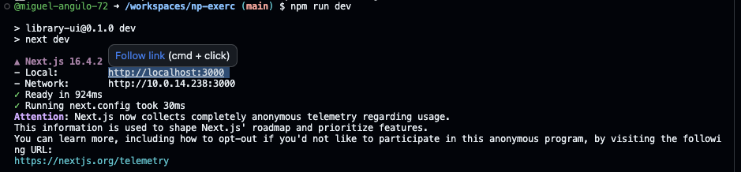

# Library-UI

## Run the Project Online (GitHub Codespaces)

You can explore the source code and run the application directly in your browser using GitHub Codespaces. No local setup is required.

**[Open Project in GitHub Codespaces](https://codespaces.new/verusmick/np-exerc)**

1. Click the link above and create a new Codespace using your GitHub account.
2. Wait for the environment to initialize. Dependencies will be installed automatically, and the Next.js development server will start.
3. The application preview should open automatically inside the editor.

**If the preview doesn't appear or shows a blank page:**

- Click the [http://localhost:3000](http://localhost:3000) link in the Codespaces terminal to open the application.

